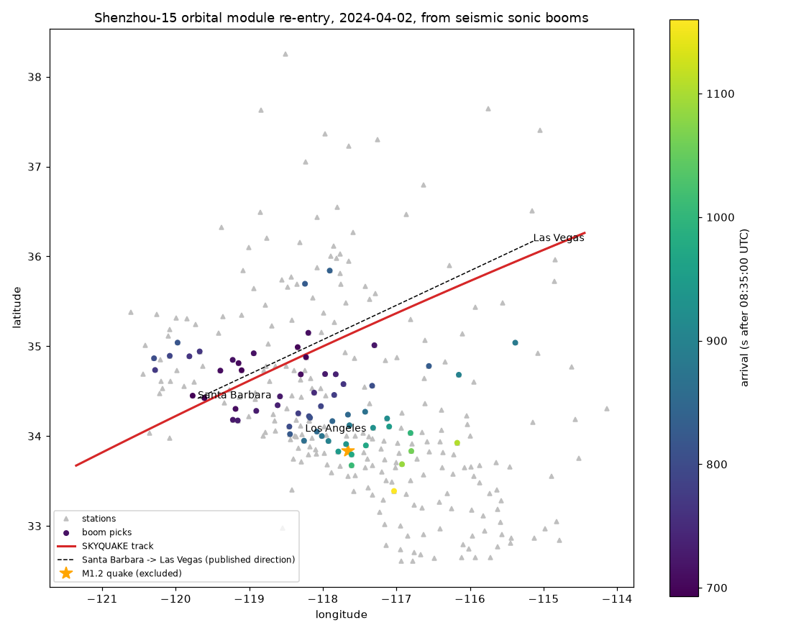

<div align="center">

# SKYQUAKE

**Track falling space debris with the world's earthquake sensors.**

When a satellite or rocket stage re-enters the atmosphere, its sonic boom shakes the ground.
Thousands of public seismometers record it, and nobody looks at the data.
SKYQUAKE turns those recordings into a trajectory, a heading, a speed, and a debris corridor,
all with honest error bars.

`pre-alpha` · `python 3.11+` · `20 tests passing` · [method](docs/method.md) · [validation](docs/validation.md) · [Türkçe](README.tr.md)

</div>

---

## Why this matters

- **Re-entries are now routine.** Several Starlink satellites re-enter every day, and
  rocket stages and other spacecraft come down regularly.
- **Predictions are coarse.** An uncontrolled re-entry is often forecast only to within
  hours. At about 7.5 km/s, a one-hour window spans tens of thousands of kilometres of
  ground track.
- **The evidence already exists.** In February 2025, a Falcon 9 upper stage fell on western
  Poland. In April 2024, the Shenzhou-15 orbital module crossed Southern California and was
  recorded by more than 100 seismometers. Reconstructing such an event still takes a
  research team weeks of manual work.

SKYQUAKE aims to reduce that work to one command.

## What it does today (v0.1, pre-alpha)

```text
public seismometers ──► sonic-boom picks ──► Mach-cone inversion ──► trajectory + uncertainty ──► GeoJSON
   (FDSN / IRIS)          (STA/LTA, SNR)       (robust, multi-start)     (calibrated, Monte Carlo)
```

| Stage | Status |
|---|---|
| WGS84 geodesy (station curvature handled exactly) | ✅ tested |
| Closed-form Mach-cone arrival model | ✅ tested against brute-force minimisation |
| Robust inversion: blind heading search, outlier rejection | ✅ tested |
| Path-averaged sound speed estimated from the data | ✅ tested |
| Calibrated 1-sigma uncertainties | ✅ tested on 40 noisy realisations |
| Monte-Carlo debris corridor and GeoJSON output | ✅ |
| Seismic download and automatic picking (ObsPy) | 🟡 works on a real event, but noisy (about half the picks rejected) |
| First real event: Shenzhou-15, 2024-04-02 | 🟡 time, heading and track agree with published work; **speed biased high** ([validation](docs/validation.md)) |
| Real atmosphere (winds, stratification), deceleration, dark flight | ⏳ [roadmap](ROADMAP.md) |

## Quick start

```bash
git clone https://github.com/00UtKu00/skyquake && cd skyquake
pip install -e ".[all,dev]"

skyquake demo                 # synthetic end-to-end run, no network
skyquake fit examples/synthetic_picks.csv -o track.geojson
skyquake events               # real validation events in the catalogue
```

Run on real data (this downloads public seismograms):

```bash
skyquake pick --lat 52.4 --lon 16.9 --radius-km 300 \
  --start 2025-02-19T03:40:00 --end 2025-02-19T04:00:00 -o picks.csv
# review picks.csv by eye, then:
skyquake fit picks.csv -o track.geojson
```

Open `track.geojson` in [geojson.io](https://geojson.io) or QGIS.

## First real event: Shenzhou-15 orbital module (2024-04-02)



From 297 public seismometers, 62 automatic sonic-boom picks give a track heading 65.5°
over Santa Barbara at 08:43:51 UTC, 56.7 km up. Time, heading and track agree with the
published reconstruction. The fitted speed (9.9 km/s) is physically too high, and the
[validation page](docs/validation.md) explains why and what comes next.

## Demo output (synthetic)

60 stations, 0.3 s pick noise, and 3 deliberately corrupted picks:

```text
parameter         truth  recovered   1-sigma  error/sigma
cross_km         -7.150     -7.148     0.016         0.10
height_km        32.458     32.511     0.064         0.81
azimuth_deg     118.000    118.009     0.010         0.89
fpa_deg           6.000      6.022     0.026         0.85
speed_kms         4.200      4.180     0.015        -1.36
t0_s             17.179     17.043     0.084        -1.62

rms residual 0.246 s, 57 stations used
note: rejected 3 outlier pick(s) > 4.0 sigma
```

The errors stay within about 1.5σ, which is what a correctly calibrated uncertainty looks
like.

## Honesty policy

Like any measurement tool, SKYQUAKE is only as good as its error bars. So:

1. **Every number has an uncertainty**, and the test suite checks that those uncertainties
   are neither over- nor under-confident.
2. **Known biases are measured and published.** For example, assuming the wrong sound speed
   by 5 % moves the along-track position by about 100 km. That is why the sound speed is
   estimated from the data by default. See [validation](docs/validation.md).
3. **Failures are reported too.** Real-event results, good or bad, go in
   [docs/validation.md](docs/validation.md).
4. **Synthetic success is not real-world validation.** Until the table in
   [validation](docs/validation.md) shows real events, treat outputs as research-grade
   estimates, not as safety information.

## How it works (one paragraph)

A body moving faster than sound drags a conical shock wave behind it. A station at distance
`r` from the flight line hears the boom at `t = t0 + x/v + r·√(1/c² − 1/v²)`, where `x` is
its along-track position, `v` the object's speed and `c` the speed of sound. Arrival times
from dozens of stations over-determine the six trajectory parameters, plus the sound speed.
SKYQUAKE solves this inverse problem with a robust, multi-start least-squares fit, rejects
bad picks, and propagates the covariance into a ground corridor.
Full derivation and assumptions: [docs/method.md](docs/method.md).

## Data sources

All data comes from public archives: FDSN seismic services (EarthScope/IRIS, ORFEUS, GFZ,
and others) and public satellite catalogues for cross-checks. See
[docs/data-sources.md](docs/data-sources.md).

## Prior work

The seismic tracking of re-entries was demonstrated by researchers at Johns Hopkins
University and Imperial College London for the Shenzhou-15 orbital module (2024). SKYQUAKE
is an independent, open implementation. Its goal is to make this kind of analysis
automatic, repeatable, and available to everyone.

## Contributing

Issues and pull requests are welcome, especially real-event picks, station metadata
fixes, and atmospheric modelling. See [CONTRIBUTING.md](CONTRIBUTING.md).

## License

To be decided before the public release. Until then, all rights reserved.
